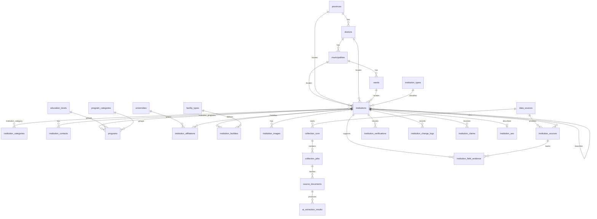

# Database schema

ShikshaKhoj stores the directory in MySQL using `utf8mb4` / `utf8mb4_unicode_ci`, so Nepali names can be stored as normal text. Primary keys are unsigned big integers. Laravel timestamps are on every application table. `institutions` is the only table that uses soft deletes.

Migrations add tables. They do not seed provinces, districts, or institutions. Official geography belongs to the next milestone. Test factories insert rows whose names start with `Synthetic` and addresses on `example.test`. Those rows are for automated tests, not the public directory.

## Responsibilities

| Area | Tables | Role |
| --- | --- | --- |
| Geography | `provinces`, `districts`, `municipalities`, `wards`, `geographic_datasets`, `geographic_aliases` | Nepal's administrative divisions and the dataset each import came from. Institutions point here instead of storing place names. |
| Classification | `institution_types`, `institution_categories`, `institution_category` | Broad type plus many specific categories. |
| Institutions | `institutions` | Central record: identity, location, publication, and branch link. |
| Contacts | `institution_contacts` | Many phones, emails, and profiles per institution. |
| Academics | `education_levels`, `program_categories`, `programs`, `institution_programs` | A program can be offered by many institutions. |
| Affiliations | `universities`, `institution_affiliations` | University and constituent relationships, including history. Not every institution has one. |
| Facilities | `facility_types`, `institution_facilities` | Only facilities recorded for that institution. |
| Media | `institution_images` | Stored file paths. This milestone does not download files. |
| Sources | `data_sources`, `institution_sources` | Where a fact came from. One institution can have many pages. |
| Collection | `collection_runs`, `collection_jobs`, `source_documents`, `ai_extraction_results` | Future crawl and model audit trail. No API keys. |
| Evidence | `institution_field_evidence` | One source-backed value per field, such as a phone number. |
| Review | `institution_verifications`, `institution_change_logs`, `institution_claims` | Review history, edits, and future ownership claims. |
| SEO | `institution_seo` | One metadata row per institution. `indexable` defaults to false. |

`users`, `sessions`, `cache`, and `jobs` remain the framework tables from the foundation.

Geographic rows carry `code`, `is_active`, and `geographic_dataset_id`. `geographic_datasets` stores the source organization, URL, version, retrieval date, checksum, levels, and validation status. `geographic_aliases` can hold a historical or alternate name without replacing the official name. Province and district `name_ne` may be null when the selected source does not provide Unicode Nepali. Empty source values do not erase a Nepali name already stored. Records missing from a later file are left in place rather than deleted. See `docs/geography/NEPAL_GEOGRAPHIC_DATA.md`.

## Relationships

Foreign keys use `restrict` for reference data (geography, types, programs, sources) so a lookup row cannot disappear while something still points at it. Rows owned by an institution (contacts, images, evidence, SEO, and similar) use `cascade` on hard delete. Soft delete does not cascade. `parent_institution_id` uses `null` on delete so a removed parent does not delete branches. Reviewer columns point at `users` and become null if that user is removed.

## Important columns

`users.is_admin` marks staff who may create and review institution records. Institution types and categories are separate. Categories may have a parent category. `institutions.management_type` is a controlled value and is not the same column as `ownership_type`. Publication status and verification status remain separate. Approving a record does not change verification status.

`institutions.slug` is unique. Slugs are generated from the English name. An existing slug is kept when a record is edited unless a new slug is submitted. A duplicate name receives a numeric suffix such as `-2`. Nepali names are stored as Unicode and are not transliterated into the slug. `name` and `name_ne` are Unicode strings. `registration_number` is optional and indexed, not unique. `ownership_type` and `management_type` are separate. `management_type` is free text because operators may need local labels. `status` defaults to `draft`. `verification_status` defaults to `unverified`. `published_at` stays empty until a later review step publishes the row.

`wards` is unique on `municipality_id` plus `ward_number`. `institution_category` is unique on the institution and category pair. `institution_programs` is unique on institution and program. `institution_facilities` is unique on institution and facility type. `institution_contacts` is unique on institution, contact type, and value. `institution_sources` is unique on institution, data source, and page URL, so one source can still contribute multiple pages. `source_documents.content_hash` is unique when present, which blocks processing the same document body twice. `institution_seo.institution_id` is unique.

## Indexes

Beyond primary keys and foreign-key indexes:

- Institution slug, status, verification status, and registration number.
- Compound institution indexes on `(status, province_id)`, `(status, district_id)`, `(status, municipality_id)`, and `(status, verification_status)` for directory listings and review queues.
- Contact lookup on `(institution_id, contact_type)`.
- Affiliation lookup on institution status and university type.
- Data source lookup on `(source_type, is_active)` and `(data_source_id, source_identifier)`.
- Collection jobs on `(status, scheduled_at)`.
- Source document content hash and extraction status.
- Field evidence on `(institution_id, field_name, review_status)`.

JSON is limited to source configuration, collection metadata, raw model responses, parsed extraction payloads, token usage, verification evidence, claim evidence, and change-log values.

## Status values

PHP backed enums in `app/Enums` match the database enum columns.

| Enum | Values |
| --- | --- |
| `InstitutionStatus` | `draft`, `pending`, `published`, `rejected`, `archived` |
| `VerificationStatus` | `unverified`, `source_matched`, `admin_reviewed`, `institution_verified` |
| `OwnershipType` | `government`, `community`, `private`, `public`, `nonprofit`, `other`, `unknown` |
| `ContactType` | `phone`, `email`, `website`, `facebook`, `instagram`, `youtube`, `other` |
| `MunicipalityType` | `metropolitan`, `sub_metropolitan`, `municipality`, `rural_municipality` |
| `AvailabilityStatus` | `available`, `unavailable`, `unknown` |
| `CollectionStatus` | `pending`, `running`, `completed`, `failed` |
| `ExtractionStatus` | `pending`, `completed`, `failed`, `skipped` |
| `SourceType` | `government`, `university`, `educational_board`, `institution_website`, `municipality`, `other` |
| `AccessMethod` | `manual`, `http`, `api`, `file` |
| `AffiliationType` | `affiliated`, `constituent`, `other` |
| `AffiliationStatus` | `active`, `inactive`, `expired`, `pending` |
| `FieldReviewStatus` | `pending`, `accepted`, `rejected` |
| `ClaimStatus` | `pending`, `approved`, `rejected` |
| `ImageType` | `logo`, `campus`, `classroom`, `infrastructure`, `other` |

`data_sources.authority_level` is a number from 0 to 255. A higher number means a more trusted source. It does not publish or verify an institution by itself. `crawl_frequency` and `university_type` stay plain strings so they can change without a schema change.

## Provenance and collection

A public field should be explainable. `institution_sources` records the page. `institution_field_evidence` records the extracted and normalized value for one column, with confidence and review state. `ai_extraction_results` keeps the provider, model, prompt version, raw response, and parsed payload. `institution_change_logs` keeps old and new JSON values when a later milestone writes edits. `institution_verifications` keeps each review decision. SEO rows stay non-indexable until publication rules say otherwise.

Nothing in this schema calls DeepSeek or fetches a page.
